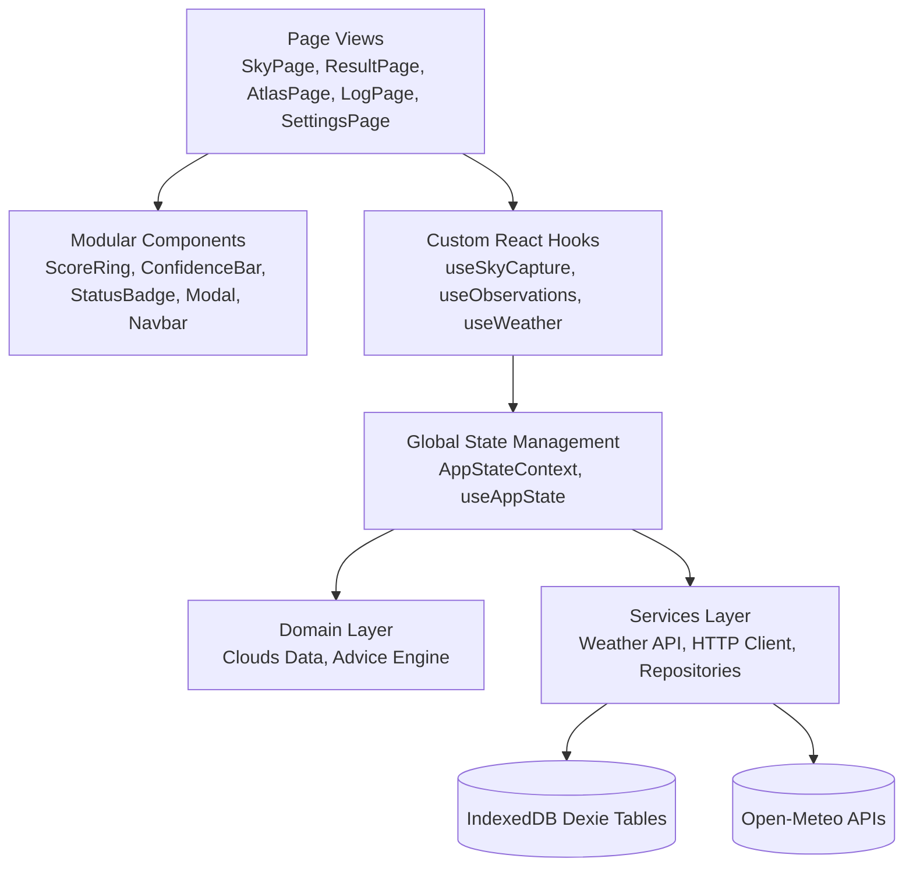

# SkyReader Architecture Specification

## 1. Architectural Overview

SkyReader is designed following **Clean Architecture** and **Feature Separation** principles. The application isolates pure business logic, external API integrations, persistent IndexedDB storage, and React UI presentation into decoupled, modular layers.



---

## 2. Directory & Modular Structure

```
web/
├── .env                  # Local environment configuration
├── .env.example          # Template environment configuration
├── src/
│   ├── config/           # Environment variables, app constants, & endpoints
│   │   ├── env.ts        # Typed environment configuration with fallbacks
│   │   └── constants.ts  # Core constants (verdict colors, default coords, keys)
│   ├── types/            # Centralized TypeScript definitions
│   │   ├── cloud.ts      # Cloud genera, altitude bands, signals
│   │   ├── weather.ts    # Weather forecasts & geocoding contracts
│   │   ├── advice.ts     # Verdicts, penalties, advice engine results
│   │   ├── settings.ts   # Activity profiles, model packs, preferences
│   │   ├── database.ts   # Dexie table schemas
│   │   └── api.ts        # HTTP client request options and error types
│   ├── utils/            # Pure helpers and custom errors
│   │   ├── errors.ts     # AppError, NetworkError, ApiError, CameraError
│   │   └── formatters.ts # Relative time, temperature/wind speed conversions
│   ├── domain/           # Pure, framework-agnostic business logic
│   │   ├── clouds/       # 10 WMO Genera + Clear sky classification definitions
│   │   └── advice/       # TRD-compliant advice scoring, heuristics & storm rules
│   ├── services/         # Infrastructure & API layer
│   │   ├── api/          # Resilient HTTP client with retry and timeout, Weather API
│   │   ├── storage/      # Dexie DB setup and typed repositories
│   │   └── ml/           # Machine learning inference service abstraction
│   ├── state/            # Centralized state management
│   │   ├── types.ts      # AppState, AppAction definitions
│   │   ├── AppStateContext.tsx # Context, Reducer, and LocalStorage sync
│   │   └── useAppState.ts# Convenient hook for consuming app state
│   ├── hooks/            # Custom React hooks (business logic extracted from UI)
│   │   ├── useSkyCapture.ts   # Camera stream, drag-and-drop, image orientation
│   │   ├── useObservations.ts # Observation statistics and filtering
│   │   └── useWeather.ts      # Location resolution and weather querying
│   ├── components/       # Reusable presentation components
│   │   ├── common/       # ScoreRing, ConfidenceBar, StatusBadge, Modal, ErrorBoundary, Toast
│   │   ├── icons/        # Centralized SVG icons (Sky, Log, Atlas, Settings, Camera, etc.)
│   │   └── layout/       # Navbar (desktop + mobile) and SkyBackground
│   ├── pages/            # Page controllers (Sky, Result, Atlas, Log, Settings, Onboarding)
│   ├── test/             # Comprehensive unit and component tests
│   ├── App.tsx           # Root layout with ErrorBoundary & ToastContainer
│   └── main.tsx          # Application bootstrap & routing
```

---

## 3. Separation of Concerns

### Domain Layer (`src/domain/`)
- Contains zero React dependencies.
- **`clouds/cloudData.ts`**: Complete WMO 10 genera definitions, altitude bands, spotter guides, and meteorological meanings.
- **`advice/adviceEngine.ts`**: Pure calculation of outdoor verdicts starting at 100, subtracting weather penalties (rain, wind gusts, UV, CAPE storm energy, heat/cold), enforcing hard storm caps (Cumulonimbus or thunderstorm weather codes cap verdict at "Wait"), and generating human-readable suggestions.

### Infrastructure & Services Layer (`src/services/`)
- **`api/client.ts`**: Resilient HTTP client with `AbortController` timeout handling, automatic exponential backoff retries on transient network and server failures, and typed error responses.
- **`api/weatherApi.ts`**: Connects to Open-Meteo geocoding and hourly weather APIs with coarse coordinate rounding (~0.1°) for privacy.
- **`storage/repositories.ts`**: Type-safe repository abstraction over Dexie IndexedDB tables (`ObservationRepository`, `SettingRepository`, `WeatherSnapshotRepository`, `PredictionRepository`, `AdviceRepository`, `OutcomeCheckRepository`).
- **`ml/inferenceService.ts`**: Abstraction for on-device neural network inference with temperature softmax scaling and uncertainty rejection thresholds.

### State Management (`src/state/`)
- Managed centrally with `AppStateContext` and `useReducer`.
- Persists user preferences (`theme`, `units`, `locationMode`, `activity`, `activeModel`) to `localStorage` and synchronizes with IndexedDB.
- Provides a centralized notification toast queue and manages active scan results across route navigations without prop-drilling.

### Presentation Layer (`src/pages/` & `src/components/`)
- UI pages are thin presentation views delegating all business logic to custom hooks (`useSkyCapture`, `useObservations`, `useWeather`).
- Common visual components (`ScoreRing`, `ConfidenceBar`, `StatusBadge`, `Modal`, `Navbar`, `Toast`) are completely modularized and reusable.
- The entire app is guarded by an `ErrorBoundary` to gracefully handle unexpected runtime errors.
